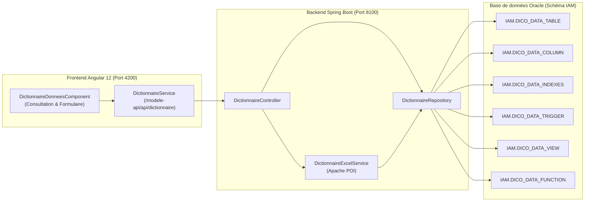
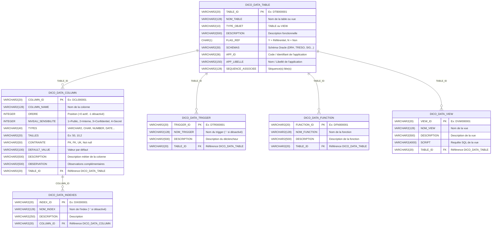

# Documentation Technique et Fonctionnelle — Module Dictionnaire de Données (CNaPS / Lucy)

## 1. Présentation Générale

Le module **Dictionnaire de Données** est une application intégrée au portail **Lucy** (`/dictionnaire`), conçue de manière autonome vis-à-vis du module de revue des habilitations (`RevuServices`).

Il répond à deux besoins complémentaires au sein de la CNaPS :
1. **Consulter le dictionnaire de données** : parcourir les applications documentées dans le référentiel `IAM.DICO_DATA_*`, filtrer les tables et vues rattachées à chaque application (affichées avec leur préfixe de schéma sous la forme `SCHEMA.NOM_OBJET`, ex. `DRH.AGENT_DSI`, `TRESO.TB_TEST_2`), inspecter la structure détaillée des colonnes, les niveaux de sensibilité (1 à 4), les index, les séquences, les déclencheurs (triggers), les relations de clés étrangères et le script SQL des vues, puis exporter la documentation d'un objet au format officiel Excel (`.xlsx`).
2. **Concevoir / Documenter un dictionnaire (`Nouveau dictionnaire` & `Compléter / Modifier`)** : saisir ou mettre à jour la structure complète d'une table ou d'une vue (pour une application existante ou une nouvelle application en cours de conception) conformément au modèle standard CNaPS (`DICO DE DONNES.xlsx`), avec persistance directe dans les 6 tables `IAM.DICO_DATA_*`.

### Règles de Sécurité et Contraintes Techniques
- **Métadonnées uniquement** : aucune requête ne lit le contenu métier des tables (`SELECT *` interdit) ni le volume d'enregistrements.
- **Confidentialité des accès** : les identifiants techniques de connexion (`DatabaseCredentials` : `username`, `password`) ne sont jamais stockés ni exposés par l'API.
- **Compatibilité avec les privilèges Oracle `DEV_DEPL` (Zéro `DELETE`)** : sur le serveur Oracle de la CNaPS (`192.168.1.100:1521/m20`), le compte applicatif `DEV_DEPL` dispose des droits `SELECT`, `INSERT` et `UPDATE` sur `IAM.*`, mais pas du privilège `DELETE`. Toutes les opérations de sauvegarde et de modification dans `DictionnaireRepository.enregistrer()` fonctionnent donc exclusivement par **`SELECT` + `INSERT` / `UPDATE`** (les lignes d'anciennes colonnes, index ou triggers retirées lors d'une modification sont désactivées logiquement via `ORDRE = -1` ou `NOM = '-'`).

---

## 2. Architecture de l'Application



### Arborescence des fichiers du module

#### Backend (`projetV2/backend`)
| Fichier | Rôle |
| :--- | :--- |
| `src/main/java/mg/cnaps/modele/dictionnaire/DictionnaireController.java` | Contrôleur REST exposant les endpoints `/api/dictionnaire/*` (consultation, enregistrement, export Excel). |
| `src/main/java/mg/cnaps/modele/dictionnaire/DictionnaireRepository.java` | Accès JDBC aux tables `IAM.DICO_DATA_*` (lecture des applications, tables/vues, colonnes, index, triggers, séquences et sauvegarde transactionnelle par `SELECT` / `INSERT` / `UPDATE`). |
| `src/main/java/mg/cnaps/modele/dictionnaire/DictionnaireDTO.java` | Objets de transfert de données (`Application`, `FicheApplication`, `Objet`, `Colonne`, `Trigger`, `Index`, `Sequence`, `Relation`, `DetailObjet`, `FormulaireObjet`, `FormulaireColonne`). |
| `src/main/java/mg/cnaps/modele/dictionnaire/DictionnaireExcelService.java` | Génération du fichier `.xlsx` à 14 colonnes avec cellules fusionnées par application et par table via Apache POI. |
| `sql/schema_dico_data.sql` | Script DDL Oracle de création des 6 tables `IAM.DICO_DATA_*`, des 6 séquences `IAM.SEQ_DICO_DATA_*` et des 6 triggers `IAM.TRG_DICO_DATA_*_BI`. |
| `sql/local_iam_grants.sql` | Script optionnel contenant les `GRANT` vers `DEV_DEPL` (à exécuter uniquement par un DBA ou le propriétaire `IAM` en environnement local). |

#### Frontend (`projetV2/modele-front-lucy/modele-front-lucy`)
| Fichier | Rôle |
| :--- | :--- |
| `src/app/modules/DictionnaireDonnees/dictionnaire-donnees.module.ts` | Module Angular lazy-loadé sur la route `/dictionnaire`. |
| `src/app/modules/DictionnaireDonnees/services/dictionnaire.service.ts` | Service HTTP typé communiquant avec `/modele-api/api/dictionnaire`. |
| `src/app/modules/DictionnaireDonnees/pages/dictionnaire-donnees/dictionnaire-donnees.component.ts` | Logique de la page : bascule Consultation / Création, filtrage par application, recherche `SCHEMA.TABLE`, pré-remplissage pour modification et export Excel. |
| `src/app/modules/DictionnaireDonnees/pages/dictionnaire-donnees/dictionnaire-donnees.component.html` | Template HTML structuré en deux vues (Formulaire de conception en 4 étapes & Catalogue de consultation) avec icônes vectorielles SVG filaires. |
| `src/app/modules/DictionnaireDonnees/pages/dictionnaire-donnees/dictionnaire-donnees.component.scss` | Feuille de style unifiée selon la charte graphique CNaPS (`#0b5cad`) et la typographie `--font-cnaps` (`Poppins`, `Montserrat`, `Segoe UI`, `Roboto`). |

---

## 3. Modèle de Données Oracle (`IAM.DICO_DATA_*`)

Toutes les tables du dictionnaire de données sont stockées dans le schéma **`IAM`** :



---

## 4. Règles de Gestion et Concepts Métiers Clés

### 4.1. Distinction entre Code de l'application (`APP_ID`), Libellé (`APP_LIBELLE`) et Schéma (`SCHEMAS`)
Dans l'étape **01** du formulaire de création :
- **Code de la nouvelle application (`APP_ID`)** : identifiant court et unique (acronyme en majuscules comme `SIG`, `GEST_PRETS`, `PAIE`, ou l'UUID `app_id` issu du modèle `ApplicationLucy`). C'est cette clé qui permet de regrouper plusieurs tables sous une même application.
- **Nom / Libellé de l'application (`APP_LIBELLE`)** : nom complet et lisible affiché aux utilisateurs dans le sélecteur d'application et sur la fiche application (ex. *Système d'Information Géographique*, *Gestion des Prêts et Avances*). Lorsqu'on ajoute une nouvelle table à une application existante, le backend conserve automatiquement l'`APP_LIBELLE` déjà enregistré.
- **Schéma Oracle dédié (`SCHEMAS`)** : propriétaire Oracle (`OWNER`) où réside la table ou la vue (`DRH`, `TRESO`, `SIG`, `IAM`...).

### 4.2. Table Référentielle (`FLAG_REF` / `flag_ref`)
Dans l'étape **02** du formulaire, la case à cocher **« Table Référentielle (`flag_ref`) »** (disponible lorsque le type est `TABLE`) alimente la colonne `IAM.DICO_DATA_TABLE.FLAG_REF` :
- **Cochée (`'Y'`)** : indique une **table de référence (nomenclature / paramétrage)** contenant des codifications stables partagées (ex. `SIG.SIG_DR` pour les Directions Régionales, tables des banques, statuts, catégories). Elle affiche un badge **`RÉFÉRENTIEL`** sur la fiche de consultation et ajoute la mention `TABLE REFERENCIELLE` dans la colonne C lors de l'export Excel.
- **Décochée (`'N'`, par défaut)** : indique une **table métier / transactionnelle** classique (ex. agents, paiements, mouvements).

### 4.3. Saisie de plusieurs Séquences, Triggers et Code SQL (Étape 04)
- **Séquence(s) associée(s) (`SEQUENCE_ASSOCIEE`)** : permet de saisir une ou plusieurs séquences séparées par une virgule (ex. `SIG.SEQ_SIG_DR, SIG.SEQ_AUTRE`). Le backend les découpe automatiquement à la virgule pour les afficher individuellement dans l'onglet *Triggers & séquences*.
- **Déclencheur(s) / Triggers (`IAM.DICO_DATA_TRIGGER`)** : champ multiligne où **chaque retour à la ligne (`Entrée`) crée un enregistrement distinct** dans `IAM.DICO_DATA_TRIGGER` (relation `1..N`), au format `NOM_TRIGGER : Description du déclencheur`.
- **Script de création de la vue (`IAM.DICO_DATA_VIEW.SCRIPT`)** : affiché lorsque le type d'objet sélectionné est `VUE` (`VIEW`).

### 4.4. Mise en place d'une Date de Création / Modification des Objets
Deux approches complémentaires peuvent être utilisées pour tracer les dates sur les objets :
1. **Dans le référentiel documentaire (`IAM.DICO_DATA_TABLE`)** :
   Ajout de deux colonnes alimentées automatiquement par Oracle (`DEFAULT SYSDATE`) :
   ```sql
   ALTER TABLE IAM.DICO_DATA_TABLE ADD (
       DATE_CREATION     DATE DEFAULT SYSDATE,
       DATE_MODIFICATION DATE DEFAULT SYSDATE
   );
   ```
   Lors d'un `INSERT`, `DATE_CREATION` prend automatiquement la date du jour ; lors d'un `UPDATE` dans `DictionnaireRepository.enregistrer()`, `DATE_MODIFICATION = SYSDATE` trace la dernière mise à jour.
2. **Depuis le catalogue système Oracle (`ALL_OBJECTS`)** :
   Pour les tables déjà créées physiquement dans Oracle, les colonnes `ALL_OBJECTS.CREATED` et `ALL_OBJECTS.LAST_DDL_TIME` fournissent la date de création physique (`CREATE TABLE`) et de dernier `ALTER TABLE` sans modifier la structure de `IAM.DICO_DATA_TABLE`.

---

## 5. Correspondance avec le Format Excel Officiel (`DICO DE DONNES.xlsx`)

Le formulaire de saisie et le service d'export (`DictionnaireExcelService`) respectent exactement les **14 colonnes** du modèle Excel de la CNaPS :

| # | Colonne Excel | Source `IAM.DICO_DATA_*` | Champ Formulaire / Affichage |
| :-: | :--- | :--- | :--- |
| **A** | `APPLICATION` | `DICO_DATA_TABLE.APP_LIBELLE` + `APP_ID` | Contexte de l'application (Étape 01) |
| **B** | `SCHEMAS` | `DICO_DATA_TABLE.SCHEMAS` | Schéma Oracle propriétaire (affiché en préfixe `SCHEMA.TABLE`) |
| **C** | `TABLES/VUES DESCRIPTION` | `DICO_DATA_TABLE.NOM_TABLE`, `TYPE_OBJET`, `FLAG_REF`, `DESCRIPTION` | Définition de l'objet (Étape 02) |
| **D** | `COLONNES` | `DICO_DATA_COLUMN.COLUMN_NAME` | Grille des colonnes — `COLONNE *` |
| **E** | `NIVEAU DE SENSIBILITE` | `DICO_DATA_COLUMN.NIVEAU_SENSIBILITE` | `1 - Public`, `2 - Interne`, `3 - Confidentiel`, `4 - Secret` |
| **F** | `TYPES` | `DICO_DATA_COLUMN.TYPES` | `VARCHAR2`, `CHAR`, `NUMBER`, `DATE`, `TIMESTAMP`, `CLOB`, `BLOB` |
| **G** | `TAILLES` | `DICO_DATA_COLUMN.TAILLES` | Taille ou précision (ex. `50`, `10,2`) |
| **H** | `CONTRAINTE` | `DICO_DATA_COLUMN.CONTRAINTE` | `PK`, `FK`, `Not null`, `UK`, `PK, Not null` |
| **I** | `VALEUR PAR DEFAUT` | `DICO_DATA_COLUMN.DEFAULT_VALUE` | Valeur par défaut (ex. `SYSDATE`, `'N'`) |
| **J** | `DESCRIPTION DES COLONNES` | `DICO_DATA_COLUMN.DESCRIPTION` | Description fonctionnelle du champ |
| **K** | `SEQUENCE` | `DICO_DATA_TABLE.SEQUENCE_ASSOCIEE` | Séquence(s) associée(s) (Étape 04) |
| **L** | `DESCRIPTION DES TRIGGERS` | `DICO_DATA_TRIGGER.NOM_TRIGGER` + `DESCRIPTION` | Déclencheur(s) / Triggers (Étape 04) |
| **M** | `NOM INDEXE` | `DICO_DATA_INDEXES.NOM_INDEX` | Grille des colonnes — `NOM INDEXÉ` |
| **N** | `OBSERVATION` | `DICO_DATA_COLUMN.OBSERVATION` | Grille des colonnes — `OBSERVATION` |

---

## 6. Charte Graphique et Ergonomie (Frontend CNaPS Lucy)

- **Typographie unifiée (`--font-cnaps`)** : utilisation de la pile sans-serif institutionnelle CNaPS (`"Poppins", "Montserrat", "Segoe UI", Roboto, "Helvetica Neue", Arial, sans-serif`) avec lissage haute précision (`-webkit-font-smoothing: antialiased`) sur l'ensemble des titres, listes de tables, formulaires et badges `<code>`.
- **Icônes vectorielles filaires (SVG)** : remplacement de tous les emojis système par des icônes SVG monochromes (`stroke="currentColor"`) sobres et modernes sur les boutons d'action (*Consulter*, *Nouveau dictionnaire*, *Ajouter une colonne*, *Supprimer*, *Enregistrer*, *Compléter / Modifier*, *Exporter*).

---

## 7. API REST (`/modele-api/api/dictionnaire`)

| Méthode | Endpoint | Description |
| :---: | :--- | :--- |
| `GET` | `/api/dictionnaire/applications` | Retourne la liste des applications déclarées dans `IAM.DICO_DATA_TABLE` avec le nombre d'objets et les schémas utilisés. |
| `GET` | `/api/dictionnaire/applications/{code}` | Retourne la fiche synthétique d'une application (`FicheApplication`). |
| `GET` | `/api/dictionnaire/objets?application={code}` | Retourne toutes les tables et vues enregistrées dans `IAM.DICO_DATA_TABLE` (tous schémas confondus), filtrées optionnellement par application. |
| `GET` | `/api/dictionnaire/schemas/{schema}/objets/{nom}` | Retourne le détail complet (`DetailObjet`) d'une table ou d'une vue : colonnes, sensibilité, contraintes, triggers, séquences, index, relations FK et script SQL. |
| `POST` | `/api/dictionnaire/objets` | Crée ou met à jour une table/vue et l'ensemble de ses colonnes, index, triggers et script de vue dans `IAM.DICO_DATA_*`. |
| `GET` | `/api/dictionnaire/schemas/{schema}/export?objet={nom}&application={code}` | Génère et télécharge le fichier Excel `.xlsx` au format officiel CNaPS. |

---

## 8. Compilation, Exécution et Dépannage

### Backend (Spring Boot / Java 11)
```powershell
cd projetV2/backend
mvn compile
mvn spring-boot:run
```
Le serveur démarre sur `http://localhost:8100/modele-api`.

### Frontend (Angular 12)
```powershell
cd projetV2/modele-front-lucy/modele-front-lucy
# Avec Node.js 17+, activer le provider OpenSSL legacy :
$env:NODE_OPTIONS='--openssl-legacy-provider'
npx ng serve
```
L'interface est accessible sur `http://localhost:4200/dictionnaire`.

### Notes de dépannage courantes
- **`ORA-01031: privilèges insuffisants` sur les commandes `GRANT`** : se produit uniquement si un utilisateur autre que `IAM` ou `SYS` tente d'exécuter des `GRANT` sur `IAM.DICO_DATA_*`. Les commandes `GRANT` ont été isolées dans `sql/local_iam_grants.sql` car `DEV_DEPL` possède déjà les privilèges nécessaires sur le serveur CNaPS.
- **Avertissements console Chrome (`[Violation] unload is not allowed` / `[Intervention] Slow network is detected`)** : messages informatifs standards du serveur de développement Webpack (`ng serve` / `sockjs.js`) et de préchargement des polices d'icônes globales du template Lucy (`nucleo-outline.woff2`, `boxicons.woff2`) ; ils n'ont aucun impact fonctionnel et disparaissent en build de production (`ng build --prod`).
