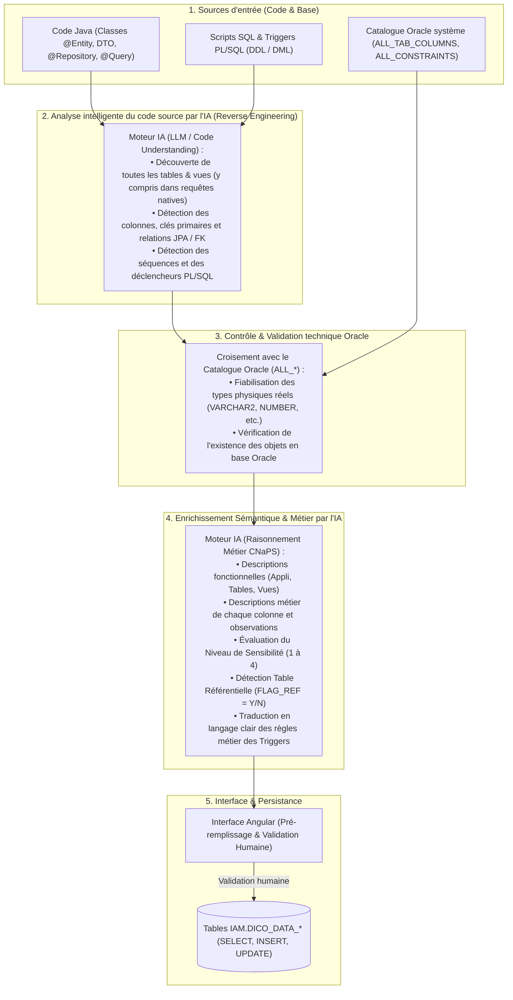
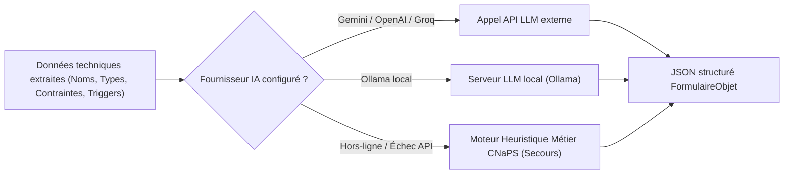
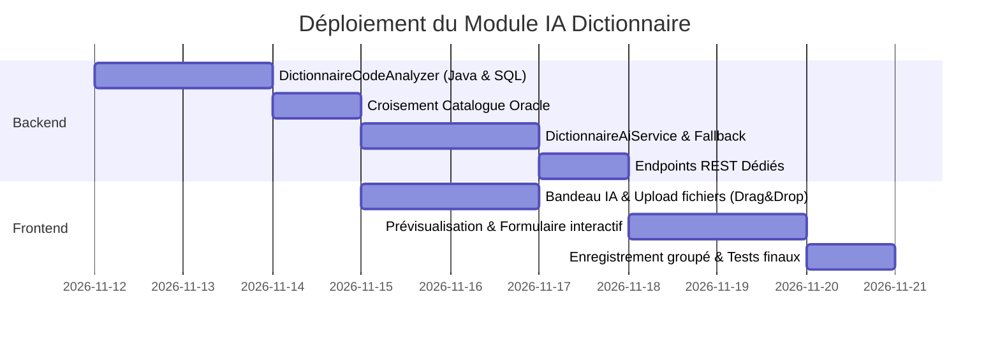

# Plan de Réalisation : Module IA de Génération Automatique du Dictionnaire de Données Oracle

> **Projet** : Portail CNaPS Lucy — Module Dictionnaire de données (`/dictionnaire`)  
> **Thème** : *« Conception et développement d'un outil intelligent de génération et de gestion du dictionnaire de données Oracle basé sur l'intelligence artificielle »*  
> **Auteur** : Direction des Systèmes d'Information (DSI / CNaPS)  
> **Date** : Novembre 2026  
> **Version** : 1.0 — Spécification technique & feuille de route

---

## 1. Contexte, Problématique & Vision

### 1.1 Problématique constatée
Au sein du système d'information de la CNaPS, la base de données Oracle centrale héberge des milliers d'objets (tables, vues, triggers, séquences) répartis sur plusieurs schémas partagés (`DRH`, `SIG`, `TRESO`, `IAM`, etc.).  
Une interrogation standard du dictionnaire système Oracle (`ALL_TABLES`, `ALL_TAB_COLUMNS`) présente plusieurs limites majeures :
1. **Absence de lien applicatif** : Oracle ignore à quelle application métier (`APP_ID`) appartient une table donnée.
2. **Absence de métadonnées sémantiques** : Les dictionnaires système ne renseignent ni les descriptions fonctionnelles, ni le caractère référentiel (`FLAG_REF`), ni le niveau de sensibilité (`1 - Public` à `4 - Secret`), ni le rôle métier des déclencheurs (*Triggers*).
3. **Documentation manuelle fastidieuse** : Renseigner les 14 colonnes du dictionnaire pour chaque table manuellement représente des centaines d'heures de saisie et reste souvent incomplet ou obsolète.

### 1.2 La solution intelligente proposée
Automatiser la découverte et la documentation du dictionnaire de données en combinant **3 piliers complémentaires** :
1. **L'analyse statique du code source** (entités Java JPA `@Entity`, classes DTO, requêtes `@Query`/`JdbcTemplate`, scripts SQL) pour capturer les objets réellement exploités par l'application.
2. **Le catalogue système Oracle (`ALL_*`)** pour extraire la structure physique exacte (types de colonnes, contraintes, index physiques, déclencheurs) sans jamais lire le contenu des enregistrements (respect strict de la confidentialité).
3. **L'Intelligence Artificielle (LLM + Moteur heuristique métier)** pour comprendre la finalité métier des tables et colonnes, rédiger les descriptions en français, déduire le niveau de sensibilité et expliciter les règles de gestion contenues dans les triggers.



---

## 2. Déroulement Détaillé en 5 Étapes

### Étape 1 : Interface d'Importation & Sélection du Code Source (Frontend Angular)
* **Emplacement** : `projetV2/modele-front-lucy/modele-front-lucy/src/app/modules/DictionnaireDonnees/`
* **Objectif** : Fournir une interface intuitive intégrée au portail Lucy pour soumettre les artefacts de code source.

#### Fonctionnalités de l'interface :
1. **Bandeau d'action rapide** dans la vue « *Nouveau dictionnaire* » avec le bouton d'appel : `✨ Assistant IA — Générer depuis le code source`.
2. **Zone de dépôt multi-fichiers (Drag & Drop)** :
   * Acceptation des extensions `.java` (entités JPA, repositories), `.sql` (scripts DDL de création de tables, vues, triggers), `.txt`.
   * Possibilité d'uploader une archive `.zip` d'un module ou d'un package de projet.
3. **Zone alternative de collage direct de code** :
   * Un champ texte avec coloration syntaxique permettant de coller directement le code d'une classe `@Entity` Java ou d'un script SQL `CREATE TABLE / VIEW`.
4. **Paramétrage initial contextuel** :
   * Sélection de l'application (existante dans `IAM.DICO_DATA_TABLE` ou nouvelle avec génération auto de son UUID).
   * Schéma Oracle cible par défaut (via le sélecteur dynamique déjà connecté à `ALL_USERS`).

---

### Étape 2 : Analyse Intelligente & Reverse Engineering du Code Source par l'IA (`DictionnaireCodeAnalyzer` & `DictionnaireAiService`)
* **Emplacement** : `projetV2/backend/src/main/java/mg/cnaps/modele/dictionnaire/service/`
* **Objectif** : Exploiter les capacités de raisonnement de l'IA (LLM) pour lire et comprendre le code source, identifier tous les objets Oracle utilisés (tables, vues, déclencheurs, séquences) et déduire leur structure technique, assisté par un parseur déterministe.

#### Pourquoi l'IA est le moteur d'analyse du code :
1. **Compréhension du code complexe & requêtes SQL natives** :
   * Un simple parseur par regex échoue sur des requêtes SQL dynamiques construites en chaînes de caractères, ou sur les requêtes `@Query(nativeQuery = true, value = "SELECT ... FROM ...")` et `JdbcTemplate.query(...)`.
   * L'IA analyse le code comme un développeur expert : elle inspecte les entités, mais aussi les Repositories et Services pour découvrir **toutes** les tables réellement touchées par l'application (y compris les tables d'autres schémas comme `DRH.REF_*` ou `TRESO.COMPTE_*`).
2. **Résolution de l'héritage JPA et des relations complexes** :
   * L'IA sait réconcilier les classes parentes abstraites (`@MappedSuperclass`), les relations `@JoinColumn` / `@ManyToOne`, et reconstituer la liste complète des colonnes d'une table.
3. **Analyse logique des Triggers PL/SQL** :
   * L'IA lit les blocs PL/SQL complexes (`BEFORE INSERT`, `AFTER UPDATE`, conditions `WHEN`, calculs) et comprend immédiatement l'événement déclencheur, les colonnes surveillées et la logique métier.
4. **Assistance du parseur déterministe (Contrôle technique)** :
   * En complément de l'IA, le composant `DictionnaireCodeAnalyzer` applique des règles déterministes strictes pour mapper fidèlement les types de données Java vers Oracle :
     | Type Java | Type Oracle déduit | Taille par défaut |
     | :--- | :--- | :--- |
     | `String` | `VARCHAR2` | Valeur de `length` (défaut : 255) |
     | `Long`, `Integer`, `Short` | `NUMBER` | Déduit de la précision JPA |
     | `BigDecimal`, `Double`, `Float` | `NUMBER` | Déduit de `precision, scale` |
     | `LocalDate`, `Date`, `Timestamp` | `DATE` / `TIMESTAMP` | — |
     | `Boolean`, `boolean` | `CHAR(1)` / `NUMBER(1)` | 1 |
     | `byte[]`, `@Lob` | `BLOB` / `CLOB` | — |

---

### Étape 3 : Croisement Automatique avec le Catalogue Oracle (`ALL_*`)
* **Emplacement** : `projetV2/backend/src/main/java/mg/cnaps/modele/dictionnaire/DictionnaireRepository.java`
* **Objectif** : Fiabiliser et compléter les objets découverts par l'IA en consultant les métadonnées physiques réelles de la base Oracle CNaPS.

#### Deux scénarios pris en charge :
1. **Cas A : L'objet existe déjà en base Oracle (Application existante)**
   * Le backend interroge `ALL_TAB_COLUMNS`, `ALL_CONSTRAINTS`, `ALL_IND_COLUMNS` et `ALL_TRIGGERS` pour ce schéma et cette table.
   * Les types réels, tailles exactes en octets (`DATA_LENGTH`), contraintes réelles (`P`, `R`, `C`), index physiques (`DICO_DATA_INDEX`) et déclencheurs compilés (`DICO_DATA_TRIGGER`) sont ajustés avec une fidélité de 100 %.
   * **Garantie de sécurité** : Aucune donnée de la table n'est lue (`SELECT *` formellement interdit). Seules les métadonnées du dictionnaire système sont consultées.
2. **Cas B : L'objet n'existe pas encore en base (Application en phase de conception)**
   * La structure complète découverte et générée par l'IA est conservée, prête à être documentée et versionnée avant création en base.

---

### Étape 4 : Enrichissement Sémantique & Raisonnement Métier par l'IA
* **Emplacement** : `projetV2/backend/src/main/java/mg/cnaps/modele/dictionnaire/service/DictionnaireAiService.java`
* **Objectif** : Générer les descriptions fonctionnelles en français, catégoriser la sensibilité (1 à 4), qualifier le type d'objet et expliquer en langage clair les déclencheurs.

#### Architecture hybride du service IA :


#### Ce que le moteur IA produit pour chaque objet :
1. **Description fonctionnelle globale de la table ou de la vue** :
   * Ex. pour `DRH.DEMANDE_PRET` : *« Table transactionnelle enregistrant les demandes de prêts et avances sur salaire formulées par les agents de la CNaPS, avec suivi du circuit de validation. »*
2. **Détermination du caractère référentiel (`FLAG_REF`)** :
   * `Y` pour les tables de nomenclature/paramétrage (`REF_*`, `TYPE_*`, `STATUT_*`, `PARAM_*`, `SIG_DR`).
   * `N` pour les tables transactionnelles de gestion de dossiers ou mouvements financiers.
3. **Description métier en français de chaque colonne (`DICO_DATA_COLUMN.DESCRIPTION`)** :
   * Ex. `ID_DEMANDE` : *« Identifiant unique technique séquentiel de la demande de prêt. »*
   * Ex. `MATRICULE_AGENT` : *« Numéro de matricule de l'agent demandeur affilié à la CNaPS. »*
   * Ex. `MONTANT_DEMANDE` : *« Montant total du prêt sollicité en Ariary (MGA). »*
4. **Classification du Niveau de Sensibilité (1 à 4)** :
   * La matrice ci-dessous est injectée dans le prompt système de l'IA ainsi que dans les règles heuristiques de secours :

| Niveau | Désignation | Critères & Types de données concernées | Exemples de colonnes CNaPS |
| :---: | :--- | :--- | :--- |
| **1** | **Public** | Nomenclatures générales, codes de référence, libellés non nominatifs, paramètres applicatifs généraux. | `CODE_TYPE`, `LIBELLE`, `FLAG_ACTIF`, `SIGLE_DIRECTION` |
| **2** | **Interne** | Données de workflow interne, dates de traitement, statuts techniques, identifiants séquentiels internes. | `DATE_DEMANDE`, `STATUT_VALIDATION`, `DATE_MODIFICATION`, `UTILISATEUR_CREATION` |
| **3** | **Confidentiel** | Données personnelles des agents ou des assurés (traçabilité individuelle, contact, coordonnées). | `MATRICULE_AGENT`, `NOM_PRENOM`, `CIN`, `NUMERO_AFFILIE`, `TELEPHONE`, `EMAIL` |
| **4** | **Secret** | Données financières sensibles, montants de salaires/pensions, coordonnées bancaires, mots de passe ou tokens de sécurité. | `MONTANT_PRET`, `SALAIRE_BASE`, `RIB_BANCAIRE`, `NUM_COMPTE`, `HASH_PASSWORD` |

5. **Explication fonctionnelle des déclencheurs (*Triggers*)** :
   * Traduction du code PL/SQL du trigger en une phrase claire décrivant la règle métier automatisée.
   * Ex. pour `TRG_BI_DEMANDE_PRET` : *« Déclencheur avant insertion assignant automatiquement le prochain numéro séquentiel et initialisant la date système. »*

---

### Étape 5 : Prévisualisation, Validation Humaine & Enregistrement
* **Emplacement** : Interface Angular Lucy (`dictionnaire-donnees.component.ts`) & Endpoint Spring Boot (`/api/dictionnaire/objets`)
* **Principe clé** : **Human-in-the-Loop** (l'IA propose, l'humain dispose).

#### Parcours utilisateur :
1. **Écran de synthèse des objets détectés** :
   * Affichage sous forme de cartes synthétiques de toutes les tables et vues trouvées dans le code source avec leur score de complétion IA.
2. **Option 1 : Contrôle & Ajustement unitaire** :
   * L'administrateur clique sur une table analysée → Les 4 étapes du formulaire (`Détails de l'objet`, `Colonnes`, `Index`, `Triggers`) sont instantanément pré-remplies avec les données extraites et générées par l'IA.
   * L'administrateur peut affiner une description ou modifier un niveau de sensibilité en un clic.
   * Clic sur **« Enregistrer dans le dictionnaire »**.
3. **Option 2 : Enregistrement groupé direct (« Tout enregistrer »)** :
   * Pour un projet contenant 10 ou 20 entités déjà vérifiées, un bouton unique permet de persister l'ensemble des objets dans les tables `IAM.DICO_DATA_*` en une seule transaction backend.
4. **Contrainte de sécurité respectée** :
   * Les enregistrements utilisent uniquement `SELECT` + `INSERT` ou `UPDATE`. Aucun `DELETE` n'est émis, restant parfaitement compatible avec les droits stricts de l'utilisateur Oracle `DEV_DEPL`.

---

## 3. Spécifications des Endpoints de l'API REST

| Méthode | URL | Description | Rôle |
| :--- | :--- | :--- | :--- |
| `POST` | `/api/dictionnaire/ai/analyser-code` | Analyse un extrait de code source (Java ou SQL) transmis en texte brut. | Étape 2 + 3 + 4 |
| `POST` | `/api/dictionnaire/ai/analyser-fichiers` | Upload et analyse unitaire ou multiple de fichiers (`.java`, `.sql`, `.zip`). | Étape 1 + 2 + 3 + 4 |
| `POST` | `/api/dictionnaire/ai/enrichir-table-oracle` | Prend une table existante dans Oracle sans code source et génère ses descriptions par IA. | Étape 4 (Reverse DB) |
| `POST` | `/api/dictionnaire/objets/lot` | Enregistre en une seule fois une liste d'objets analysés dans `IAM.DICO_DATA_*`. | Étape 5 (Batch Save) |

---

## 4. Configuration & Dépendances Requises

### 4.1 Fichier de configuration backend (`application.properties`)
```properties
# ==============================================================================
# CONFIGURATION DU MODULE IA - DICTIONNAIRE DE DONNÉES
# ==============================================================================
# Fournisseur IA actif : 'gemini', 'ollama', 'groq', ou 'expert' (secours intégré)
dico.ai.provider=expert

# Configuration API distante (ex. Google Gemini ou Groq)
dico.ai.api-key=${AI_API_KEY:}
dico.ai.model=gemini-1.5-flash

# Configuration Ollama local (si utilisé en réseau local CNaPS)
dico.ai.ollama.base-url=http://localhost:11434
dico.ai.ollama.model=qwen2.5-coder:7b

# Timeout des appels IA en secondes
dico.ai.timeout-seconds=30
```

---

## 5. Calendrier de Réalisation & Livrables



---

## 6. Bilan de Réalisation & État d'Avancement (Novembre 2026)

| Étape du Plan | Statut | Composants Réalisés | Preuve & Vérification |
| :--- | :---: | :--- | :--- |
| **Étape 1 : Interface d'Importation & Saisie Code** | **Terminé** | • Panneau IA dans Lucy (`dictionnaire-donnees.component.html`)<br/>• Zone Drag-and-Drop multi-fichiers (`.java`, `.sql`, `.zip`)<br/>• Éditeur de code avec bouton d'exemple Java JPA | Intégré dans l'UI Lucy avec les styles SCSS conformes à la charte CNaPS |
| **Étape 2 : Analyse Statique & Rétro-ingénierie Code** | **Terminé** | • `CodeAnalyzer.java` (Extraction des entités JPA, tables, vues, colonnes, PK/FK, séquences, triggers PL/SQL) | Test unitaire `CodeAnalyzerTest` validé avec succès |
| **Étape 3 : Croisement Catalogue Oracle** | **Terminé** | • `CatalogueOracle.java` (Interrogation sécurisée de `ALL_TAB_COLUMNS`, `ALL_CONSTRAINTS`, `ALL_IND_COLUMNS`, `ALL_TRIGGERS`) | Zéro lecture de données (`SELECT *` exclu), types exacts en octets |
| **Étape 4 : Enrichissement Sémantique IA** | **Terminé** | • `MoteurExpert.java` (100% hors-ligne, matrice sensibilité 1–4, français)<br/>• `MoteurLlm.java` (Gemini, Ollama, Groq)<br/>• `DictionnaireAiService.java` (Contrôle des tailles UTF-8 Oracle) | Descriptions générées, `FLAG_REF` auto, sensibilité CNaPS respectée |
| **Étape 5 : Prévisualisation & Persistance par Lot** | **Terminé** | • Cartes de synthèse avec barres de progression<br/>• Pré-remplissage interactif Human-in-the-Loop du formulaire 4 étapes<br/>• Enregistrement par lot transactionnel (`/api/dictionnaire/objets/lot`) | Persistance sans `DELETE` conforme aux privilèges `DEV_DEPL` |

---

> [!NOTE]
> Ce document sert de référentiel technique pour l'évaluation du stage et garantit une traçabilité totale entre le besoin métier exprimé par la CNaPS et la réalisation logicielle.
